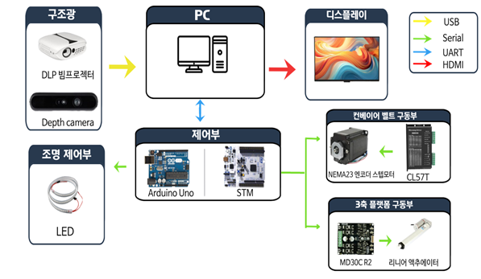
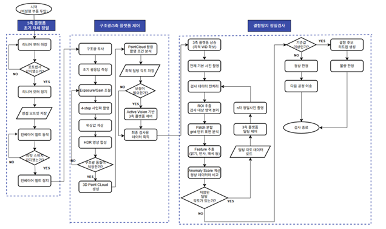

# 26_HC073 — Active Vision 및 구조광 기반 비정형 부품 정밀 검사 자동화 시스템

## 1. 프로젝트 개요

### 1-1. 프로젝트 소개

- **프로젝트명:** Active Vision 및 구조광 기반 비정형 부품 정밀 검사 자동화 시스템
- **프로젝트 번호:** 26_HC073
- **프로젝트 정의:** 구조광으로 물체의 형상과 검사 자세를 구하고, 3축 플랫폼으로 관측 조건을 조절한 뒤 정상 데이터 기반 Autoencoder로 표면 이상을 검사하는 자동화 시스템입니다.

### 1-2. 개발 배경 및 필요성

표면의 흠집과 찍힘은 관측 각도와 조명 조건에 따라 보이는 정도가 달라집니다. 고정된 시점의 영상만으로 검사하면 물체 형상에 따라 관측하기 어려운 면이 생길 수 있습니다. 이 프로젝트는 형상 정보를 이용한 능동적인 자세 조절과 검사 영역 추출을 결합하여, 일정한 광학 조건에서 표면 결함을 검사하는 것을 목표로 합니다.

### 1-3. 프로젝트 특장점

- 구조광 기반 3D 형상 분석과 Active Vision을 연결하여 검사 가능한 면과 관측 자세를 계획합니다.
- Z 높이에 따른 결합 기울기 제한을 적용하고, Depth 품질과 표면 검사 가능 영역을 기준으로 Auto-Z를 수행합니다.
- 프로젝터와 LED 제어로 구조광 촬영과 최종 RGB 검사의 광학 조건을 전환합니다.
- 물체 표면 ROI에 포함된 패치만 추론하여 배경의 영향을 줄입니다.
- 정상 Validation 입력에서 임계값을 계산하고, 현재 검사 run의 결과를 Dashboard에 표시합니다.

### 1-4. 주요 기능

| 기능 | 내용 |
|---|---|
| 자동 반입·배출 | 컨베이어와 검사 사이클 연동 |
| 구조광 형상 분석 | 패턴 촬영, 형상 복원, 검사 면·자세 정보 생성 |
| 검사 자세 조절 | 플랫폼 Roll/Pitch 조절 및 Z 높이 탐색 |
| 검사 영역 추출 | Depth와 RGB 정보를 이용한 표면 ROI 및 inspection mask 생성 |
| 이상 탐지 | GRAY/BLUE 프로필의 Autoencoder로 표면 패치 복원 오차 평가 |
| 결과 표시 | 현재 run의 PLY, 최종 RGB, ROI, 이상 점수·판정 시각화 |

### 1-5. 기대 효과 및 활용 분야

반복 가능한 자세·조명 조건을 확보하고 검사 가능한 표면에 추론을 집중하여 자동 표면 검사의 일관성을 높이는 것을 목표로 합니다. 컨베이어 기반 부품 검사와 표면 외관 검사에 활용할 수 있으며, 적용 재질과 광학 배치에 맞는 데이터 수집·보정·모델 검증이 필요합니다.

### 1-6. 기술 스택

| 구분 | 사용 기술 |
|---|---|
| 실행 환경 | Ubuntu 22.04, Python 3.10, Bash, X11 |
| 영상·수치 처리 | OpenCV, NumPy, SciPy |
| AI 추론 | PyTorch, Convolutional Autoencoder |
| 3D 처리·시각화 | Open3D, PyVista, VTK |
| 검사 UI | PySide6 |
| 센서·장치 연동 | Orbbec SDK, pyserial, USB·Serial 통신 |
| 하드웨어 | Orbbec Gemini 336L, DLP 프로젝터, 3축 플랫폼, 컨베이어, LED·커버 제어부 |

## 2. 팀원 소개

실명 대신 프로젝트의 담당 분야와 역할을 소개합니다.

| 담당 분야 | 역할 |
|---|---|
| 시스템 통합 | 검사 사이클 연결, 실행 환경 구성, 통합 검증 |
| 구조광·3D 형상 | 패턴 촬영, 형상 복원, 검사 면 및 자세 분석 |
| 하드웨어 제어 | 컨베이어·플랫폼·조명·프로젝터 커버 연동 |
| AI·검사 UI | 정상 데이터 기반 이상 탐지, 검사 결과 시각화 |
| 기술 자문 | 시스템 설계 및 프로젝트 수행에 대한 기술 검토·자문 |

## 3. 시스템 구성도

### 3-1. 하드웨어 구성도




### 3-2. 시스템 Flowchart




### 3-3. 통합 검사 흐름

1. 컨베이어로 검사체를 반입하고 플랫폼을 안전한 자세로 이동합니다.
2. 구조광 패턴을 촬영해 현재 프레임의 3D 형상과 검사 가능 면을 구하고 검사 자세를 계획합니다.
3. 플랫폼 Roll/Pitch를 조절하고 Auto-Z로 Depth 품질과 검사 가능 영역을 확인합니다.
4. 프로젝터를 BLACK으로 전환하고 물리 커버를 닫습니다. LED OFF 상태에서 최종 형상을 확인한 뒤 중립 백색 LED로 Depth ROI와 최종 RGB를 얻습니다.
5. 표면 ROI의 64×64 패치(간격 32)에 Autoencoder 추론을 적용해 결함을 판정하고, 현재 run의 PLY·이미지·결과를 Dashboard에 표시합니다.
6. 플랫폼을 초기 자세로 복귀시킨 뒤 컨베이어로 검사체를 배출합니다.

## 4. 작품 소개영상

[](https://youtu.be/_txoyyJrdkA)

[YouTube에서 작품 소개영상 보기](https://youtu.be/_txoyyJrdkA)

## 5. 핵심 소스코드

검사·제어 코드는 [`src/`](src/), 구조광 촬영과 후처리는 [`structured_light/`](structured_light/)에 있습니다.

| 구성 요소 | 핵심 코드 | 역할 |
|---|---|---|
| 실행 진입점 | [run_inspection_with_ui.py](src/tools/run_inspection_with_ui.py) | GRAY/BLUE 설정, dry-run 및 Production·UI 프로세스 실행 |
| 통합 검사 | [integrated_inspection_cycle.py](src/integration/integrated_inspection_cycle.py) | 반입, 구조광, 자세 조절, 최종 촬영, 추론 및 정리 순서 제어 |
| 구조광 연동 | [물체검사.sh](structured_light/물체검사.sh), [structured_light_runner.py](src/integration/structured_light_runner.py), [structured_light_paths.py](structured_light/structured_light_paths.py) | 촬영·후처리 실행, preflight, 보정·산출물 경로 관리 |
| 검사 자세 계획 | [real_pose_planner.py](src/integration/real_pose_planner.py) | 현재 구조광 결과의 검사 면·자세 정보 해석 |
| R/P/Z 조절 | [adaptive_pose.py](src/inspection/adaptive_pose.py), [hardware_z_search.py](src/inspection/hardware_z_search.py) | Z별 기울기 제한, 안전한 자세 전환 및 검사 높이 탐색 |
| 표면 ROI | [hybrid_inspection_roi.py](src/integration/hybrid_inspection_roi.py), [inspection_mask.py](src/core/inspection_mask.py) | Depth·RGB 기반 ROI와 최종 검사 마스크 생성 |
| 이상 탐지 | [autoencoder.py](src/autoencoder.py), [detector.py](src/anomaly/detector.py), [infer_anomaly.py](src/infer_anomaly.py) | 패치 복원, 정상 Validation 기반 임계값 계산 및 이상 점수 평가 |
| 검사 Dashboard | [industrial_dashboard.py](src/ui/industrial_dashboard.py) | 현재 run의 형상·영상·점수·판정 표시 |

아래는 [ConvAutoencoder](src/autoencoder.py)가 입력 패치를 잠재 표현으로 변환하고 복원하는 실제 코드 일부입니다.

```python
def forward(self, x: Tensor) -> Tensor:
    latent = self.encode(x)
    reconstructed = self.decode(latent)
    return reconstructed
```

최종 이상 점수와 정상 Validation 기반 임계값 계산은 [ProductionAnomalyDetector](src/anomaly/detector.py)에서 수행합니다. Production은 64×64 패치, stride 32, 표면 마스크 포함 비율 1.0을 사용합니다.

## 실행 환경과 설치

개발·실행 환경은 **Ubuntu 22.04, Python 3.10**, X11 화면과 프로젝터가 연결된 장비 PC입니다. 저장소 루트에서 실행합니다.

```bash
git clone https://github.com/ehdwls-lab/26_HC073.git
cd 26_HC073
python3.10 -m venv .venv
source .venv/bin/activate
python -m pip install --upgrade pip
python -m pip install -r requirements.txt
python -m pip install -r requirements-hardware.txt
python -m pip install -r requirements-ui.txt
```

`requirements-hardware.txt`의 `pyorbbecsdk2` 외에 Orbbec SDK의 호스트 측 구성과 장치 접근 권한을 준비해야 합니다. 구조광 화면 선택에는 `xrandr`와 동작하는 X11 `DISPLAY`가 필요합니다. `bash`는 구조광 shell 실행에 필요합니다. CloudCompare는 선택적 시각화 도구입니다. UI는 PySide6, PLY 렌더러는 PyVista/VTK를 사용합니다.

## 장비와 보정 준비

- RGB-D 카메라: **Orbbec Gemini 336L**. 카메라와 프로젝터의 설치 위치를 보정 당시와 일치시킵니다.
- 3축 플랫폼 MCU: **NUCLEO-F411RE**. PC와 펌웨어는 115200 baud의 `Z:`, `R:`, `P:`, `RST`, `MODE:` 명령 및 `TLM:` 응답을 사용합니다. 실제 보드에 플래시된 버전은 장비에서 별도로 확인해야 합니다.
- 컨베이어 Mega: `/dev/serial/by-id/usb-1a86_USB_Serial-if00-port0`
- 플랫폼 STM32: `/dev/serial/by-id/usb-STMicroelectronics_STM32_STLink_066FFF383133524157152339-if02`
- 조명·프로젝터 커버 Arduino: `/dev/serial/by-id/usb-Arduino__www.arduino.cc__0043_75932313039351C09122-if00`

세 장치의 포트 이름은 해당 PC의 USB 연결에 따라 달라질 수 있습니다. `src/tools/run_inspection_with_ui.py`의 `PORTS`를 확인하고 장비별 실제 경로와 맞추십시오. 커버 매핑은 **OPEN 90°, CLOSE 0°**입니다. 플랫폼 기계적 한계는 Roll/Pitch 각각 ±30°, 운영 자세 한계는 각각 ±25°이며, Z에 따른 결합 기울기 제한을 적용합니다. 안전 범위와 비상 정지 수단을 확인한 뒤에만 실제 실행하십시오.

다음 입력은 현재 광학 배치에 맞는 값이어야 합니다.

| 용도 | 파일 |
|---|---|
| Auto-Z 품질 | `config/automatic_z_quality.json` |
| 프로젝터 범위 | `structured_light/프로젝터 수동 범위 확인/프로젝터_세로범위.json` |
| 빈 플랫폼 Depth | `structured_light/플랫폼 바닥 따기/현재배치_기준데이터/active/E1999_G64/플랫폼_바닥_depth.npy` |

## 모델과 Validation

추론 시작 시 해당 모델과 정상 Validation 입력에서 threshold를 계산합니다. CSV가 가리키는 RGB와 `inspection_mask.png`가 모두 필요합니다.

| 프로필 | 활성 모델 | Validation CSV | 이미지·마스크 |
|---|---|---|---|
| GRAY | `models/gray_v2/best_autoencoder.pth` | `data/manifests/gray_v2/val.csv` | `data/production_validation/gray_v2/pose_08,09/` |
| BLUE | `models/blue_v1/best_autoencoder.pth` | `data/manifests/blue_v1_rot180/val.csv` | `data/production_validation/blue_v1_rot180/pose_08,09/` |

## 실행

장비를 열지 않는 설정 점검:

```bash
python -m src.tools.run_inspection_with_ui --profile gray --ui-3d-mode ply
python -m src.tools.run_inspection_with_ui --profile blue --ui-3d-mode ply
```

실제 통합 검사:

```bash
python -m src.tools.run_inspection_with_ui --profile gray --ui-3d-mode ply --execute
python -m src.tools.run_inspection_with_ui --profile blue --ui-3d-mode ply --execute
```

`--execute`는 컨베이어, 플랫폼, 카메라, 프로젝터와 조명을 실제로 동작시키며 실행 전 터미널 확인을 요구합니다. 기본 결과 경로는 저장소 아래 `results/integrated_hardware/`입니다. `results/`가 없는 clone에서도 실행 시 생성됩니다. 다른 위치를 쓰려면 `--output-root`를 지정하십시오. 검사 run의 구조광 raw·PLY, final RGB·Depth·ROI, anomaly 결과와 로그도 해당 run 아래에 생성됩니다. UI는 같은 run의 현재 산출물을 읽습니다. 결과 데이터는 GitHub에 포함되지 않습니다.

## 알려진 제한사항

- 실제 검사는 Ubuntu 22.04의 장비, X11 프로젝터, Orbbec SDK, USB 장치 권한 및 유효한 보정값이 필요합니다. dry-run은 이들 장비의 동작을 검증하지 않습니다.
- 저장소의 모델과 Validation 입력은 현재 GRAY/BLUE 프로필용입니다. 광학 배치나 검사 재질이 바뀌면 보정과 모델 적합성을 다시 확인해야 합니다.
- 기본 serial by-id 경로는 현재 장비 기준이며 다른 PC에서 장치 ID가 달라지면 설정을 맞춰야 합니다.
- MCU 펌웨어 소스와 개발·학습 자료는 별도 보관 대상이며 이 Production 저장소에 포함되지 않습니다.
